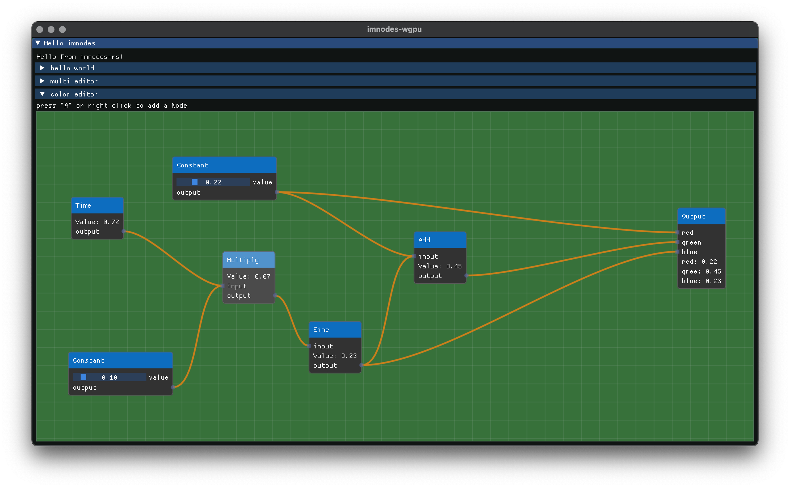

# imnodes-rs


[](https://crates.io/crates/imnodes)
[](https://crates.io/crates/imnodes-sys)

These are bindings for [imnodes](https://github.com/Nelarius/imnodes)
using [cimnodes](https://github.com/cimgui/cimnodes) for [imgui-rs](https://github.com/Gekkio/imgui-rs).

They are inspsired by [implot-rs](https://github.com/4bb4/implot-rs).



## docs

`cargo doc --no-deps --open`

## TODO/ Ideas

- add example with salsa or some other incremental computation lib

## Example (see `imnodes-wgpu-examples/src/hello_world.rs`)

```rust
pub fn show<'a>(ui: &imgui::Ui, context: &mut imnodes::EditorContext<'a>) {
    let mut id_generator = context.new_identifier_generator();

    imnodes::editor(context, |mut editor| {
        editor.add_node(id_generator.next_node(), |mut node| {
            node.add_titlebar(|| ui.text("simple node :)"));
            node.add_input(
                &imnodes::InputAttributeDesc {
                    id: id_generator.next_input_pin(),
                    shape: imnodes::PinShape::Circle,
                },
                || ui.text("input"),
            );
            node.add_output(
                &imnodes::OutputAttributeDesc {
                    id: id_generator.next_output_pin(),
                    shape: imnodes::PinShape::QuadFilled,
                },
                || ui.text("output"),
            );
        });
    });
}
```

If you are looking for a pure rust gui node editor:  <https://github.com/emilk/egui/discussions/166>
